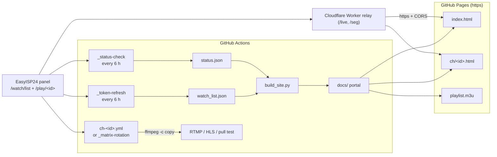

<!-- AUTO:HEADER:START -->
<p align="center"></p>
<p align="center"></p>

<p align="center">
      
</p>

<p align="center">
<a href="https://muaaziqbalvip.github.io/nowirehetv/docs"></a>        <a href="https://github.com/muaaziqbalvip/nowirehetv/blob/main/LICENSE"></a>
</p>

<p align="center">
<a href="https://github.com/muaaziqbalvip/nowirehetv/actions/workflows/_token-refresh.yml"></a>  <a href="https://github.com/muaaziqbalvip/nowirehetv/actions/workflows/_status-check.yml"></a>  <a href="https://github.com/muaaziqbalvip/nowirehetv/actions/workflows/_site-build.yml"></a>  <a href="https://github.com/muaaziqbalvip/nowirehetv/commits/main"></a>
</p>
<!-- AUTO:HEADER:END -->

<div align="center">

**A self-healing live-TV publishing pipeline for the EasyISP24 panel (v1.0.59) - and for any panel you point `config.json` at.**

GitHub Actions refreshes the rotating token every 6 hours, probes every channel, rebuilds
clean M3U playlists, a searchable portal and per-channel HLS players, and can fan the
streams out to a restream destination 24/7 - one workflow per channel.

</div>

<div align="center">

### ⚡ Browser playback 101 (read this first)

The panel speaks **plain HTTP on a raw IP**, so an HTTPS page (GitHub Pages) is **not allowed**
to play it directly - the browser blocks it as mixed content. Native players (VLC, mpv, TiviMate,
OTT Navigator) play the M3U links fine right now. For in-browser playback you need the HTTPS
relay, which is a 2-minute, free, one-click deploy:

<p>
<a href="https://deploy.workers.cloudflare.com/?url=https://github.com/muaaziqbalvip/nowirehetv"></a>
</p>

After deploying, put the printed `https://<name>.<subdomain>.workers.dev` URL into
`config.json` → `proxy.base_url` (or paste it in the box on any channel page) and every link,
M3U and player switches to HTTPS. Nothing else to configure.

</div>

---

## ✨ What you get

| | |
| --- | --- |
| 🛰 **Token-aware catalog bot** | Reads `/watch/list`, keeps all 170 channels (including the ones the panel marks offline so they auto-recover), stores the token privately, publishes only URLs. |
| 🩺 **Health checks** | Every channel is probed twice-deep (master → media playlist): state, HTTP code, latency, variants, bitrate, live-window detection → `status.json`. |
| 📺 **Portal that actually loads** | Static `docs/` site: animated dashboard with search + group/state filters, one hls.js player per channel with quality selector, copy-link buttons, live/offline badges. |
| 🎚 **Clean M3U output** | `playlist.m3u` + `playlist/<id>.m3u`, two lines per channel, commas sanitised out of attribute values. |
| 🔁 **24/7 restream engine** | `scripts/restart_loop.sh` pulls HLS, pushes RTMP / writes HLS / supervised pull, restarts with exponential backoff, re-reads the token mid-run, and hands over before GitHub's 6-hour cap. |
| 🌐 **HTTPS relay** | `scripts/proxy_worker.js` (Cloudflare Worker) hides the origin IP + token and turns plain-HTTP HLS into HTTPS URLs that work in every browser and IPTV app. |
| ⚙️ **One generator, three modes** | `scripts/generate_workflows.py` emits one workflow per channel, a rotating matrix, or nothing at all (portal-only) depending on your minutes budget. |
| 🧪 **Tested** | `python3 -m pytest` (or `unittest`) covers token handling, M3U formatting, URL building, site build and workflow generation. |

---

## 🧭 Architecture



---

## 📊 Live status

<!-- AUTO:STATS:START -->
| Metric | Value |
| --- | --- |
| **Channels in catalog** | `170` |
| **Streaming right now** | `101` (59% healthy) |
| **Dead / unreachable** | `69` |
| **Panel reports online** | `101` |
| **Average probe latency** | _pending first health check_ |
| **Best bitrate** | _pending first health check_ |
| **Catalog refreshed** | `2026-10-31T08:39:33Z` (38m ago) |
| **Portal URL** | [**muaaziqbalvip.github.io/nowirehetv/docs**](https://muaaziqbalvip.github.io/nowirehetv/docs) |
| **Relay (https layer)** | _not configured - direct links are plain HTTP_ |

**Groups:** Sports `38` · Bangla `28` · News `26` · Movies `21` · Other `19` · Entertainment `16` · Kids `12` · Infotainment `10`
<!-- AUTO:STATS:END -->

---

## 🚀 Quick start

### 1. Use this repo

```bash
git clone https://github.com/<you>/<repo>.git && cd <repo>
python3 scripts/bootstrap_catalog.py        # only if watch_list.json is empty
python3 scripts/build_site.py               # build docs/ locally
python3 -m http.server --directory docs 8080 # http://localhost:8080
```

### 2. Turn on GitHub Pages

`Settings → Pages → Source: Deploy from a branch → Branch: `main` + folder `/docs` → Save`

The build also writes a copy of the dashboard to the repo root (`index.html` + `.nojekyll`),
so Pages works **either** with `main /docs` **or** with the default `main /` -
`https://<user>.github.io/<repo>/` redirects straight into the portal. Every internal link is
relative, so a custom domain or `file://` works too.

### 3. Enable the bots

`Actions → I understand my workflows, go ahead and enable them`, then run once by hand:

| Workflow | What it does |
| --- | --- |
| `_token-refresh` | Fetches a fresh token + catalog → `watch_list.json`, `token.json` (gitignored), rebuilds `docs/`, updates this README |
| `_status-check` | Probes all channels → `status.json`, rebuilds `docs/`, updates this README |
| `_site-build` | Rebuilds `docs/` from committed data (runs on code changes too) |

Both bots run on `17 */6 * * *` / `47 */6 * * *`, commit with `[skip ci]`, and push with
`--rebase` retries under a shared `site-publish` concurrency group, so they never fight.

### 4. (Recommended) Deploy the HTTPS relay

Browsers block `http://` streams inside an `https://` page, so the portal's inline player
needs the relay for real playback. VLC / mpv / TiviMate work either way.

```bash
npx wrangler login
npx wrangler kv namespace create TOKEN_KV     # optional but recommended
npx wrangler deploy                            # prints https://<name>.<sub>.workers.dev
```

Then set it once in `config.json`:

```json
"proxy": { "base_url": "https://easyisp24-restream.<your-subdomain>.workers.dev" }
```

…run `_site-build`, and **every** link on the site, every M3U and every README badge
switches to HTTPS. You can also paste the relay URL into the box on any channel page -
it is stored in `localStorage` and rewrites links instantly, no rebuild needed.

<details>
<summary>Relay routes</summary>

| Route | Returns |
| --- | --- |
| `GET /live/<id>.m3u8` | playlist with every segment/variant rewritten to the relay |
| `GET /live/<id>/<variant>.m3u8` | variant playlist |
| `GET /seg/<id>/<file>` | proxied media segment (`.ts`, `.m4s`, `.key`) |
| `GET /playlist.m3u` | full HTTPS M3U for IPTV apps |
| `GET /ch/<id>.m3u` | single channel M3U |
| `GET /list` | `/watch/list` JSON with the token stripped |
| `GET /health` | relay + panel diagnostic JSON |

The token lives in KV (auto-refreshed on a 403 and cached for an hour), never in the page.
</details>

### 5. (Optional) Turn on 24/7 restream

Set `mode` and `dest_mode` in `config.json`, then regenerate:

```bash
python3 scripts/generate_workflows.py
git add .github && git commit -m "chore: regenerate restream workflows" && git push
```

| `mode` | What the generator does | Minutes |
| --- | --- | --- |
| `portal-only` *(default)* | Writes the per-channel workflows **inert** into `.github/workflows.disabled/`. Only the 6-hourly bots run. | ~0 (few seconds per run) |
| `github-free` | Dispatch-only per-channel workflows + a rotating matrix that streams N channels per 6-hour slot and walks the whole catalog. Fits the 2,000 min/month budget. | ≈ 2,000 min |
| `github-hosted` *(current)* | **One active 24/7 workflow per channel** on `ubuntu-latest`: cron every 6 h, manual run, `repository_dispatch` and a per-channel push kick (`data/trigger/<id>`). Restart loop + 355-minute handover. | free for public repos, but GitHub allows only ~20 concurrent jobs, so 170 channels take turns in the queue |
| `selfhosted` | One cron workflow per channel on `[self-hosted, linux]`, staggered starts, 355-minute jobs that hand over seamlessly. | free on your own runner, **all 170 channels truly simultaneous** |

| `dest_mode` | Behaviour |
| --- | --- |
| `rtmp` | `ffmpeg -c copy -f flv rtmp://.../<id>?auth=<key>` (nginx-rtmp, MediaMTX, any ingest) - key comes from the `RTMP_KEY` secret |
| `hls-rehost` | Writes a rolling 4 s / 8-segment HLS window to `out/<id>/` (push it to an orphan `streams` branch or object storage) |
| `proxy-only` | No ffmpeg fan-out, the Worker relays the panel - health checks + supervised pull only |

Concurrency policy: `restream.max_parallel` (3), `max-parallel: 3` in the matrix,
10 s stagger per channel, polite `VLC/3.0.20` user agent, exponential backoff
5 s → 120 s, and `timeout 21000` inside a 355-minute job so the next cron continues
the stream without gaps.

---

## 🗂 Repository layout

```text
config.json                  every panel/destination/site switch (nothing hardcoded elsewhere)
watch_list.json              catalog written by the token bot (no token inside)
status.json                  per-channel health (state, http, latency, variants, bitrate)
data/seed_channels.txt       captured catalog, used only to bootstrap a fresh fork
scripts/
  common.py                  stdlib-only helpers (urls, m3u, http, slugs, repo detection)
  refresh_token.py           token + catalog refresh with backoff and stale fallback
  health_check.py            concurrent deep probe -> status.json
  build_site.py              renders docs/ (dashboard, players, playlists, JSON)
  update_readme.py           refreshes the AUTO blocks in this file
  generate_workflows.py      per-channel workflows / rotation / disabled copies
  rotation_plan.py           picks this slot's channels for the matrix
  restart_loop.sh            ffmpeg supervisor (RTMP / HLS / pull) with token refresh
  heartbeat.sh               per-run heartbeat file
  proxy_worker.js            Cloudflare Worker HTTPS relay
  deploy_worker.sh           wrangler helper
templates/                   HTML/CSS/JS used by build_site.py
docs/                        the generated GitHub Pages site (committed)
tests/                       pytest/unittest suite
.github/workflows/           _token-refresh, _status-check, _site-build, _worker-deploy, matrix rotation
.github/workflows.disabled/  generated per-channel streaming workflows - inert until you switch mode
```

---

## 🎛 Configuration cheat-sheet

```jsonc
{
  "source_base": "http://103.151.60.162:2122",   // any panel
  "list_path": "/watch/list",
  "play_url_template": "/play/<ID>/index.m3u8?token=<TOKEN>",
  "auth_mode": "token-query",                    // none | token-query | token-header | cookie
  "auth": { "token_field": "token", "query_param": "token", "header_name": "X-Token" },
  "mode": "portal-only",                         // selfhosted | github-free | portal-only
  "dest_mode": "proxy-only",                     // rtmp | hls-rehost | proxy-only
  "proxy": { "base_url": "" },                   // Cloudflare Worker URL -> https links
  "site": { "title": "EasyISP24 Restream", "output_dir": "docs", "publish_direct_urls": true },
  "restream": { "max_parallel": 3, "stagger_seconds": 10, "job_timeout_minutes": 355 }
}
```

Pointing this at another panel is a `config.json` edit + `python3 scripts/generate_workflows.py`.
Nothing panel-specific lives in code.

---

## 📻 Playlists & endpoints

```text
https://<user>.github.io/<repo>/playlist.m3u          full catalog
https://<user>.github.io/<repo>/playlist/<id>.m3u     one channel
https://<user>.github.io/<repo>/data/channels.json    machine-readable catalog + status
https://<user>.github.io/<repo>/status.json           health report
https://<relay>/playlist.m3u                          HTTPS playlist for IPTV apps
```

Format is strictly two lines per channel, and commas are stripped from attribute
values so no parser trips over `WWE 24*7` or `UDP 228.2.2.2:1053 #1907`:

```m3u
#EXTM3U
#EXTINF:-1 tvg-id="be7u" tvg-name="Star Plus" tvg-logo="" group-title="Entertainment",Star Plus
https://relay.example.workers.dev/live/be7u.m3u8
```

---

## 🛠 Troubleshooting

| Symptom | Fix |
| --- | --- |
| Portal shows "HTTPS relay not configured" | Deploy the Worker and set `proxy.base_url` (or paste the URL into a channel page). Direct panel links are plain HTTP and blocked by browsers on HTTPS. |
| Per-channel workflows are not running | They only exist when `mode` is `github-hosted`/`selfhosted`; run `python3 scripts/generate_workflows.py`. To start one right now without the API: `bash scripts/kick.sh be7u`. |
| Player spinner then "Network error" | Token rotated mid-session or channel is offline. Re-run `_status-check`; the playlist is rebuilt on every bot run. |
| `403 Invalid token` in Actions logs | The loop refreshes automatically; if it persists, the panel changed its token format → update `auth.token_field`. |
| `watch_list.json` marked `stale: true` | Panel was unreachable during refresh. The bot keeps the last good catalog and retries next run; nothing breaks. |
| Pages 404 on a channel | The channel was removed from the panel; rerun `_token-refresh` - stale pages are deleted automatically. |
| Workflows missing after switching mode | Run `python3 scripts/generate_workflows.py --clean`; active vs. disabled directories are managed for you. |
| Free minutes exhausted | Switch `mode` to `portal-only` (default) or `github-free`; the portal keeps working either way. |

---

## ➕ Adding or removing channels

The catalog belongs to the panel - never hand-edit `watch_list.json`. When the panel adds a
channel, the next `_token-refresh` picks it up; then run:

```bash
python3 scripts/generate_workflows.py --clean
python3 scripts/build_site.py
python3 scripts/update_readme.py
```

`_site-build` does the last two automatically on every push.

---

## ⚖️ Legal

This is infrastructure, not a content licence. You must own or be authorised to redistribute
every channel you pull, and you are responsible for the panel you point it at. Tokens are
treated as secrets (`token.json` is gitignored); the public portal only ever exposes URLs.
The maintainers accept no liability for misuse.

---

## 🇵🇰 Quick start (Roman Urdu)

1. **Fork / clone** karein, phir `Settings → Pages → Deploy from a branch → main / docs` on karein.
2. **Actions** tab mein workflows enable karein aur `_token-refresh` + `_status-check` ek dafa manually run karein - `watch_list.json`, `status.json` aur poora `docs/` site khud ban jayega.
3. **Portal link**: `https://<user>.github.io/<repo>/` - har channel ka player, M3U aur copy-link button wahan milega.
4. **Browser mein playback** ke liye Cloudflare Worker deploy karein (`npx wrangler deploy`), uska URL `config.json → proxy.base_url` mein daalein aur `_site-build` chala dein. Iske baghair links HTTP honge - VLC/TiviMate mein chalenge, browser mein nahi.
5. **24/7 restream** chahiye to `config.json` mein `mode` (`selfhosted` ya `github-free`) aur `dest_mode` (`rtmp` / `hls-rehost`) set karke `python3 scripts/generate_workflows.py` chalayein.
6. Default `mode` = `portal-only` hai: saare links, badges, playlists aur health checks kaam karte hain aur GitHub minutes almost zero kharch hote hain.

---

## 📈 Channel catalog

<!-- AUTO:CATALOG:START -->
170 channels · 🟢 live · 🔴 dead · ⚪ panel says offline. Names link to the browser player, `id` to the single-channel M3U.

| | Channel | ID | Group | Links | Latency | Bitrate |
|:--:| --- | --- | --- | --- | --- | --- |
| 🟢 | [asiantvHD](https://muaaziqbalvip.github.io/nowirehetv/docs/ch/bkyl.html) | [`bkyl`](https://muaaziqbalvip.github.io/nowirehetv/docs/playlist/bkyl.m3u) | Bangla | [player](https://muaaziqbalvip.github.io/nowirehetv/docs/ch/bkyl.html) · [m3u](https://muaaziqbalvip.github.io/nowirehetv/docs/playlist/bkyl.m3u) | - | - |
| 🟢 | [Bangla Vision](https://muaaziqbalvip.github.io/nowirehetv/docs/ch/bcb3.html) | [`bcb3`](https://muaaziqbalvip.github.io/nowirehetv/docs/playlist/bcb3.m3u) | Bangla | [player](https://muaaziqbalvip.github.io/nowirehetv/docs/ch/bcb3.html) · [m3u](https://muaaziqbalvip.github.io/nowirehetv/docs/playlist/bcb3.m3u) | - | - |
| 🟢 | [BanglaTV HD](https://muaaziqbalvip.github.io/nowirehetv/docs/ch/b5jz.html) | [`b5jz`](https://muaaziqbalvip.github.io/nowirehetv/docs/playlist/b5jz.m3u) | Bangla | [player](https://muaaziqbalvip.github.io/nowirehetv/docs/ch/b5jz.html) · [m3u](https://muaaziqbalvip.github.io/nowirehetv/docs/playlist/b5jz.m3u) | - | - |
| 🟢 | [BijoyTV](https://muaaziqbalvip.github.io/nowirehetv/docs/ch/b511.html) | [`b511`](https://muaaziqbalvip.github.io/nowirehetv/docs/playlist/b511.m3u) | Bangla | [player](https://muaaziqbalvip.github.io/nowirehetv/docs/ch/b511.html) · [m3u](https://muaaziqbalvip.github.io/nowirehetv/docs/playlist/b511.m3u) | - | - |
| 🟢 | [BTV Chattagram](https://muaaziqbalvip.github.io/nowirehetv/docs/ch/bamp.html) | [`bamp`](https://muaaziqbalvip.github.io/nowirehetv/docs/playlist/bamp.m3u) | Bangla | [player](https://muaaziqbalvip.github.io/nowirehetv/docs/ch/bamp.html) · [m3u](https://muaaziqbalvip.github.io/nowirehetv/docs/playlist/bamp.m3u) | - | - |
| 🟢 | [BTV HD](https://muaaziqbalvip.github.io/nowirehetv/docs/ch/brwl.html) | [`brwl`](https://muaaziqbalvip.github.io/nowirehetv/docs/playlist/brwl.m3u) | Bangla | [player](https://muaaziqbalvip.github.io/nowirehetv/docs/ch/brwl.html) · [m3u](https://muaaziqbalvip.github.io/nowirehetv/docs/playlist/brwl.m3u) | - | - |
| 🟢 | [Channel I HD](https://muaaziqbalvip.github.io/nowirehetv/docs/ch/bmbq.html) | [`bmbq`](https://muaaziqbalvip.github.io/nowirehetv/docs/playlist/bmbq.m3u) | Bangla | [player](https://muaaziqbalvip.github.io/nowirehetv/docs/ch/bmbq.html) · [m3u](https://muaaziqbalvip.github.io/nowirehetv/docs/playlist/bmbq.m3u) | - | - |
| 🟢 | [Colors Bangla HD](https://muaaziqbalvip.github.io/nowirehetv/docs/ch/b0v8.html) | [`b0v8`](https://muaaziqbalvip.github.io/nowirehetv/docs/playlist/b0v8.m3u) | Bangla | [player](https://muaaziqbalvip.github.io/nowirehetv/docs/ch/b0v8.html) · [m3u](https://muaaziqbalvip.github.io/nowirehetv/docs/playlist/b0v8.m3u) | - | - |
| 🟢 | [Enterr10 Bangla](https://muaaziqbalvip.github.io/nowirehetv/docs/ch/bxqa.html) | [`bxqa`](https://muaaziqbalvip.github.io/nowirehetv/docs/playlist/bxqa.m3u) | Bangla | [player](https://muaaziqbalvip.github.io/nowirehetv/docs/ch/bxqa.html) · [m3u](https://muaaziqbalvip.github.io/nowirehetv/docs/playlist/bxqa.m3u) | - | - |
| 🟢 | [Madani TV](https://muaaziqbalvip.github.io/nowirehetv/docs/ch/bx72.html) | [`bx72`](https://muaaziqbalvip.github.io/nowirehetv/docs/playlist/bx72.m3u) | Bangla | [player](https://muaaziqbalvip.github.io/nowirehetv/docs/ch/bx72.html) · [m3u](https://muaaziqbalvip.github.io/nowirehetv/docs/playlist/bx72.m3u) | - | - |
| 🟢 | [NTV HD EN-1](https://muaaziqbalvip.github.io/nowirehetv/docs/ch/bhb3.html) | [`bhb3`](https://muaaziqbalvip.github.io/nowirehetv/docs/playlist/bhb3.m3u) | Bangla | [player](https://muaaziqbalvip.github.io/nowirehetv/docs/ch/bhb3.html) · [m3u](https://muaaziqbalvip.github.io/nowirehetv/docs/playlist/bhb3.m3u) | - | - |
| 🟢 | [Ruposhi Bangla](https://muaaziqbalvip.github.io/nowirehetv/docs/ch/b5wy.html) | [`b5wy`](https://muaaziqbalvip.github.io/nowirehetv/docs/playlist/b5wy.m3u) | Bangla | [player](https://muaaziqbalvip.github.io/nowirehetv/docs/ch/b5wy.html) · [m3u](https://muaaziqbalvip.github.io/nowirehetv/docs/playlist/b5wy.m3u) | - | - |
| 🟢 | [SA TV HD](https://muaaziqbalvip.github.io/nowirehetv/docs/ch/bv6p.html) | [`bv6p`](https://muaaziqbalvip.github.io/nowirehetv/docs/playlist/bv6p.m3u) | Bangla | [player](https://muaaziqbalvip.github.io/nowirehetv/docs/ch/bv6p.html) · [m3u](https://muaaziqbalvip.github.io/nowirehetv/docs/playlist/bv6p.m3u) | - | - |
| 🟢 | [Sony Aath](https://muaaziqbalvip.github.io/nowirehetv/docs/ch/brft.html) | [`brft`](https://muaaziqbalvip.github.io/nowirehetv/docs/playlist/brft.m3u) | Bangla | [player](https://muaaziqbalvip.github.io/nowirehetv/docs/ch/brft.html) · [m3u](https://muaaziqbalvip.github.io/nowirehetv/docs/playlist/brft.m3u) | - | - |
| 🟢 | [Star Bangla](https://muaaziqbalvip.github.io/nowirehetv/docs/ch/biy1.html) | [`biy1`](https://muaaziqbalvip.github.io/nowirehetv/docs/playlist/biy1.m3u) | Bangla | [player](https://muaaziqbalvip.github.io/nowirehetv/docs/ch/biy1.html) · [m3u](https://muaaziqbalvip.github.io/nowirehetv/docs/playlist/biy1.m3u) | - | - |
| 🟢 | [Star Jalsha](https://muaaziqbalvip.github.io/nowirehetv/docs/ch/bxvd.html) | [`bxvd`](https://muaaziqbalvip.github.io/nowirehetv/docs/playlist/bxvd.m3u) | Bangla | [player](https://muaaziqbalvip.github.io/nowirehetv/docs/ch/bxvd.html) · [m3u](https://muaaziqbalvip.github.io/nowirehetv/docs/playlist/bxvd.m3u) | - | - |
| 🟢 | [Sun Bangla HD](https://muaaziqbalvip.github.io/nowirehetv/docs/ch/b539.html) | [`b539`](https://muaaziqbalvip.github.io/nowirehetv/docs/playlist/b539.m3u) | Bangla | [player](https://muaaziqbalvip.github.io/nowirehetv/docs/ch/b539.html) · [m3u](https://muaaziqbalvip.github.io/nowirehetv/docs/playlist/b539.m3u) | - | - |
| 🟢 | [Zee Bangla E](https://muaaziqbalvip.github.io/nowirehetv/docs/ch/bl29.html) | [`bl29`](https://muaaziqbalvip.github.io/nowirehetv/docs/playlist/bl29.m3u) | Bangla | [player](https://muaaziqbalvip.github.io/nowirehetv/docs/ch/bl29.html) · [m3u](https://muaaziqbalvip.github.io/nowirehetv/docs/playlist/bl29.m3u) | - | - |
| 🟢 | [Zee Bangla HD](https://muaaziqbalvip.github.io/nowirehetv/docs/ch/byix.html) | [`byix`](https://muaaziqbalvip.github.io/nowirehetv/docs/playlist/byix.m3u) | Bangla | [player](https://muaaziqbalvip.github.io/nowirehetv/docs/ch/byix.html) · [m3u](https://muaaziqbalvip.github.io/nowirehetv/docs/playlist/byix.m3u) | - | - |
| 🟢 | [Colors HD](https://muaaziqbalvip.github.io/nowirehetv/docs/ch/bkys.html) | [`bkys`](https://muaaziqbalvip.github.io/nowirehetv/docs/playlist/bkys.m3u) | Entertainment | [player](https://muaaziqbalvip.github.io/nowirehetv/docs/ch/bkys.html) · [m3u](https://muaaziqbalvip.github.io/nowirehetv/docs/playlist/bkys.m3u) | - | - |
| 🟢 | [Colors Infinity HD](https://muaaziqbalvip.github.io/nowirehetv/docs/ch/b1y7.html) | [`b1y7`](https://muaaziqbalvip.github.io/nowirehetv/docs/playlist/b1y7.m3u) | Entertainment | [player](https://muaaziqbalvip.github.io/nowirehetv/docs/ch/b1y7.html) · [m3u](https://muaaziqbalvip.github.io/nowirehetv/docs/playlist/b1y7.m3u) | - | - |
| 🟢 | [Hum Sitary](https://muaaziqbalvip.github.io/nowirehetv/docs/ch/b9zj.html) | [`b9zj`](https://muaaziqbalvip.github.io/nowirehetv/docs/playlist/b9zj.m3u) | Entertainment | [player](https://muaaziqbalvip.github.io/nowirehetv/docs/ch/b9zj.html) · [m3u](https://muaaziqbalvip.github.io/nowirehetv/docs/playlist/b9zj.m3u) | - | - |
| 🟢 | [Sony SET HD](https://muaaziqbalvip.github.io/nowirehetv/docs/ch/bvgy.html) | [`bvgy`](https://muaaziqbalvip.github.io/nowirehetv/docs/playlist/bvgy.m3u) | Entertainment | [player](https://muaaziqbalvip.github.io/nowirehetv/docs/ch/bvgy.html) · [m3u](https://muaaziqbalvip.github.io/nowirehetv/docs/playlist/bvgy.m3u) | - | - |
| 🟢 | [SRK TV](https://muaaziqbalvip.github.io/nowirehetv/docs/ch/blp5.html) | [`blp5`](https://muaaziqbalvip.github.io/nowirehetv/docs/playlist/blp5.m3u) | Entertainment | [player](https://muaaziqbalvip.github.io/nowirehetv/docs/ch/blp5.html) · [m3u](https://muaaziqbalvip.github.io/nowirehetv/docs/playlist/blp5.m3u) | - | - |
| 🟢 | [Star Plus](https://muaaziqbalvip.github.io/nowirehetv/docs/ch/be7u.html) | [`be7u`](https://muaaziqbalvip.github.io/nowirehetv/docs/playlist/be7u.m3u) | Entertainment | [player](https://muaaziqbalvip.github.io/nowirehetv/docs/ch/be7u.html) · [m3u](https://muaaziqbalvip.github.io/nowirehetv/docs/playlist/be7u.m3u) | - | - |
| 🟢 | [STAR Plus HD](https://muaaziqbalvip.github.io/nowirehetv/docs/ch/b8d3.html) | [`b8d3`](https://muaaziqbalvip.github.io/nowirehetv/docs/playlist/b8d3.m3u) | Entertainment | [player](https://muaaziqbalvip.github.io/nowirehetv/docs/ch/b8d3.html) · [m3u](https://muaaziqbalvip.github.io/nowirehetv/docs/playlist/b8d3.m3u) | - | - |
| 🟢 | [Zee TV](https://muaaziqbalvip.github.io/nowirehetv/docs/ch/bd11.html) | [`bd11`](https://muaaziqbalvip.github.io/nowirehetv/docs/playlist/bd11.m3u) | Entertainment | [player](https://muaaziqbalvip.github.io/nowirehetv/docs/ch/bd11.html) · [m3u](https://muaaziqbalvip.github.io/nowirehetv/docs/playlist/bd11.m3u) | - | - |
| 🟢 | [Animal Planet](https://muaaziqbalvip.github.io/nowirehetv/docs/ch/bups.html) | [`bups`](https://muaaziqbalvip.github.io/nowirehetv/docs/playlist/bups.m3u) | Infotainment | [player](https://muaaziqbalvip.github.io/nowirehetv/docs/ch/bups.html) · [m3u](https://muaaziqbalvip.github.io/nowirehetv/docs/playlist/bups.m3u) | - | - |
| 🟢 | [Discovery HD](https://muaaziqbalvip.github.io/nowirehetv/docs/ch/bw3c.html) | [`bw3c`](https://muaaziqbalvip.github.io/nowirehetv/docs/playlist/bw3c.m3u) | Infotainment | [player](https://muaaziqbalvip.github.io/nowirehetv/docs/ch/bw3c.html) · [m3u](https://muaaziqbalvip.github.io/nowirehetv/docs/playlist/bw3c.m3u) | - | - |
| 🟢 | [Discovery Science](https://muaaziqbalvip.github.io/nowirehetv/docs/ch/b49e.html) | [`b49e`](https://muaaziqbalvip.github.io/nowirehetv/docs/playlist/b49e.m3u) | Infotainment | [player](https://muaaziqbalvip.github.io/nowirehetv/docs/ch/b49e.html) · [m3u](https://muaaziqbalvip.github.io/nowirehetv/docs/playlist/b49e.m3u) | - | - |
| 🟢 | [History 18](https://muaaziqbalvip.github.io/nowirehetv/docs/ch/boee.html) | [`boee`](https://muaaziqbalvip.github.io/nowirehetv/docs/playlist/boee.m3u) | Infotainment | [player](https://muaaziqbalvip.github.io/nowirehetv/docs/ch/boee.html) · [m3u](https://muaaziqbalvip.github.io/nowirehetv/docs/playlist/boee.m3u) | - | - |
| 🟢 | [Nat Geo Wild HD](https://muaaziqbalvip.github.io/nowirehetv/docs/ch/b668.html) | [`b668`](https://muaaziqbalvip.github.io/nowirehetv/docs/playlist/b668.m3u) | Infotainment | [player](https://muaaziqbalvip.github.io/nowirehetv/docs/ch/b668.html) · [m3u](https://muaaziqbalvip.github.io/nowirehetv/docs/playlist/b668.m3u) | - | - |
| 🟢 | [Travelxp HD](https://muaaziqbalvip.github.io/nowirehetv/docs/ch/befz.html) | [`befz`](https://muaaziqbalvip.github.io/nowirehetv/docs/playlist/befz.m3u) | Infotainment | [player](https://muaaziqbalvip.github.io/nowirehetv/docs/ch/befz.html) · [m3u](https://muaaziqbalvip.github.io/nowirehetv/docs/playlist/befz.m3u) | - | - |
| 🟢 | [Cartoon Network](https://muaaziqbalvip.github.io/nowirehetv/docs/ch/b7np.html) | [`b7np`](https://muaaziqbalvip.github.io/nowirehetv/docs/playlist/b7np.m3u) | Kids | [player](https://muaaziqbalvip.github.io/nowirehetv/docs/ch/b7np.html) · [m3u](https://muaaziqbalvip.github.io/nowirehetv/docs/playlist/b7np.m3u) | - | - |
| 🟢 | [Disney International](https://muaaziqbalvip.github.io/nowirehetv/docs/ch/bbxp.html) | [`bbxp`](https://muaaziqbalvip.github.io/nowirehetv/docs/playlist/bbxp.m3u) | Kids | [player](https://muaaziqbalvip.github.io/nowirehetv/docs/ch/bbxp.html) · [m3u](https://muaaziqbalvip.github.io/nowirehetv/docs/playlist/bbxp.m3u) | - | - |
| 🟢 | [Disney Jr](https://muaaziqbalvip.github.io/nowirehetv/docs/ch/bdqh.html) | [`bdqh`](https://muaaziqbalvip.github.io/nowirehetv/docs/playlist/bdqh.m3u) | Kids | [player](https://muaaziqbalvip.github.io/nowirehetv/docs/ch/bdqh.html) · [m3u](https://muaaziqbalvip.github.io/nowirehetv/docs/playlist/bdqh.m3u) | - | - |
| 🟢 | [Nick](https://muaaziqbalvip.github.io/nowirehetv/docs/ch/b010.html) | [`b010`](https://muaaziqbalvip.github.io/nowirehetv/docs/playlist/b010.m3u) | Kids | [player](https://muaaziqbalvip.github.io/nowirehetv/docs/ch/b010.html) · [m3u](https://muaaziqbalvip.github.io/nowirehetv/docs/playlist/b010.m3u) | - | - |
| 🟢 | [Nickelodeon](https://muaaziqbalvip.github.io/nowirehetv/docs/ch/bu0e.html) | [`bu0e`](https://muaaziqbalvip.github.io/nowirehetv/docs/playlist/bu0e.m3u) | Kids | [player](https://muaaziqbalvip.github.io/nowirehetv/docs/ch/bu0e.html) · [m3u](https://muaaziqbalvip.github.io/nowirehetv/docs/playlist/bu0e.m3u) | - | - |
| 🟢 | [Pogo](https://muaaziqbalvip.github.io/nowirehetv/docs/ch/bz5z.html) | [`bz5z`](https://muaaziqbalvip.github.io/nowirehetv/docs/playlist/bz5z.m3u) | Kids | [player](https://muaaziqbalvip.github.io/nowirehetv/docs/ch/bz5z.html) · [m3u](https://muaaziqbalvip.github.io/nowirehetv/docs/playlist/bz5z.m3u) | - | - |
| 🟢 | [BANGLA CINEMA](https://muaaziqbalvip.github.io/nowirehetv/docs/ch/bzag.html) | [`bzag`](https://muaaziqbalvip.github.io/nowirehetv/docs/playlist/bzag.m3u) | Movies | [player](https://muaaziqbalvip.github.io/nowirehetv/docs/ch/bzag.html) · [m3u](https://muaaziqbalvip.github.io/nowirehetv/docs/playlist/bzag.m3u) | - | - |
| 🟢 | [ENC 2406](https://muaaziqbalvip.github.io/nowirehetv/docs/ch/bonc.html) | [`bonc`](https://muaaziqbalvip.github.io/nowirehetv/docs/playlist/bonc.m3u) | Movies | [player](https://muaaziqbalvip.github.io/nowirehetv/docs/ch/bonc.html) · [m3u](https://muaaziqbalvip.github.io/nowirehetv/docs/playlist/bonc.m3u) | - | - |
| 🟢 | [HBO HD](https://muaaziqbalvip.github.io/nowirehetv/docs/ch/bc4f.html) | [`bc4f`](https://muaaziqbalvip.github.io/nowirehetv/docs/playlist/bc4f.m3u) | Movies | [player](https://muaaziqbalvip.github.io/nowirehetv/docs/ch/bc4f.html) · [m3u](https://muaaziqbalvip.github.io/nowirehetv/docs/playlist/bc4f.m3u) | - | - |
| 🟢 | [Hits](https://muaaziqbalvip.github.io/nowirehetv/docs/ch/bw4t.html) | [`bw4t`](https://muaaziqbalvip.github.io/nowirehetv/docs/playlist/bw4t.m3u) | Movies | [player](https://muaaziqbalvip.github.io/nowirehetv/docs/ch/bw4t.html) · [m3u](https://muaaziqbalvip.github.io/nowirehetv/docs/playlist/bw4t.m3u) | - | - |
| 🟢 | [HITS MOVIES](https://muaaziqbalvip.github.io/nowirehetv/docs/ch/bxqx.html) | [`bxqx`](https://muaaziqbalvip.github.io/nowirehetv/docs/playlist/bxqx.m3u) | Movies | [player](https://muaaziqbalvip.github.io/nowirehetv/docs/ch/bxqx.html) · [m3u](https://muaaziqbalvip.github.io/nowirehetv/docs/playlist/bxqx.m3u) | - | - |
| 🟢 | [Jalsha Movies HD](https://muaaziqbalvip.github.io/nowirehetv/docs/ch/bt4k.html) | [`bt4k`](https://muaaziqbalvip.github.io/nowirehetv/docs/playlist/bt4k.m3u) | Movies | [player](https://muaaziqbalvip.github.io/nowirehetv/docs/ch/bt4k.html) · [m3u](https://muaaziqbalvip.github.io/nowirehetv/docs/playlist/bt4k.m3u) | - | - |
| 🟢 | [Movies Now HD](https://muaaziqbalvip.github.io/nowirehetv/docs/ch/bl8q.html) | [`bl8q`](https://muaaziqbalvip.github.io/nowirehetv/docs/playlist/bl8q.m3u) | Movies | [player](https://muaaziqbalvip.github.io/nowirehetv/docs/ch/bl8q.html) · [m3u](https://muaaziqbalvip.github.io/nowirehetv/docs/playlist/bl8q.m3u) | - | - |
| 🟢 | [Star Gold 2 HD](https://muaaziqbalvip.github.io/nowirehetv/docs/ch/be8c.html) | [`be8c`](https://muaaziqbalvip.github.io/nowirehetv/docs/playlist/be8c.m3u) | Movies | [player](https://muaaziqbalvip.github.io/nowirehetv/docs/ch/be8c.html) · [m3u](https://muaaziqbalvip.github.io/nowirehetv/docs/playlist/be8c.m3u) | - | - |
| 🟢 | [SUPER HIT](https://muaaziqbalvip.github.io/nowirehetv/docs/ch/bgqc.html) | [`bgqc`](https://muaaziqbalvip.github.io/nowirehetv/docs/playlist/bgqc.m3u) | Movies | [player](https://muaaziqbalvip.github.io/nowirehetv/docs/ch/bgqc.html) · [m3u](https://muaaziqbalvip.github.io/nowirehetv/docs/playlist/bgqc.m3u) | - | - |
| 🟢 | [Zee Cinema HD](https://muaaziqbalvip.github.io/nowirehetv/docs/ch/bo14.html) | [`bo14`](https://muaaziqbalvip.github.io/nowirehetv/docs/playlist/bo14.m3u) | Movies | [player](https://muaaziqbalvip.github.io/nowirehetv/docs/ch/bo14.html) · [m3u](https://muaaziqbalvip.github.io/nowirehetv/docs/playlist/bo14.m3u) | - | - |
| 🟢 | [Al Jazeera](https://muaaziqbalvip.github.io/nowirehetv/docs/ch/bjdd.html) | [`bjdd`](https://muaaziqbalvip.github.io/nowirehetv/docs/playlist/bjdd.m3u) | News | [player](https://muaaziqbalvip.github.io/nowirehetv/docs/ch/bjdd.html) · [m3u](https://muaaziqbalvip.github.io/nowirehetv/docs/playlist/bjdd.m3u) | - | - |
| 🟢 | [Ananda TV](https://muaaziqbalvip.github.io/nowirehetv/docs/ch/b1xm.html) | [`b1xm`](https://muaaziqbalvip.github.io/nowirehetv/docs/playlist/b1xm.m3u) | News | [player](https://muaaziqbalvip.github.io/nowirehetv/docs/ch/b1xm.html) · [m3u](https://muaaziqbalvip.github.io/nowirehetv/docs/playlist/b1xm.m3u) | - | - |
| 🟢 | [ATN Bangla](https://muaaziqbalvip.github.io/nowirehetv/docs/ch/brzr.html) | [`brzr`](https://muaaziqbalvip.github.io/nowirehetv/docs/playlist/brzr.m3u) | News | [player](https://muaaziqbalvip.github.io/nowirehetv/docs/ch/brzr.html) · [m3u](https://muaaziqbalvip.github.io/nowirehetv/docs/playlist/brzr.m3u) | - | - |
| 🟢 | [ATN News](https://muaaziqbalvip.github.io/nowirehetv/docs/ch/bsmy.html) | [`bsmy`](https://muaaziqbalvip.github.io/nowirehetv/docs/playlist/bsmy.m3u) | News | [player](https://muaaziqbalvip.github.io/nowirehetv/docs/ch/bsmy.html) · [m3u](https://muaaziqbalvip.github.io/nowirehetv/docs/playlist/bsmy.m3u) | - | - |
| 🟢 | [BBC World](https://muaaziqbalvip.github.io/nowirehetv/docs/ch/bw10.html) | [`bw10`](https://muaaziqbalvip.github.io/nowirehetv/docs/playlist/bw10.m3u) | News | [player](https://muaaziqbalvip.github.io/nowirehetv/docs/ch/bw10.html) · [m3u](https://muaaziqbalvip.github.io/nowirehetv/docs/playlist/bw10.m3u) | - | - |
| 🟢 | [Boishakhi TV](https://muaaziqbalvip.github.io/nowirehetv/docs/ch/b3s7.html) | [`b3s7`](https://muaaziqbalvip.github.io/nowirehetv/docs/playlist/b3s7.m3u) | News | [player](https://muaaziqbalvip.github.io/nowirehetv/docs/ch/b3s7.html) · [m3u](https://muaaziqbalvip.github.io/nowirehetv/docs/playlist/b3s7.m3u) | - | - |
| 🟢 | [BTV NEWS HD](https://muaaziqbalvip.github.io/nowirehetv/docs/ch/bex9.html) | [`bex9`](https://muaaziqbalvip.github.io/nowirehetv/docs/playlist/bex9.m3u) | News | [player](https://muaaziqbalvip.github.io/nowirehetv/docs/ch/bex9.html) · [m3u](https://muaaziqbalvip.github.io/nowirehetv/docs/playlist/bex9.m3u) | - | - |
| 🟢 | [Channel 24HD](https://muaaziqbalvip.github.io/nowirehetv/docs/ch/bee4.html) | [`bee4`](https://muaaziqbalvip.github.io/nowirehetv/docs/playlist/bee4.m3u) | News | [player](https://muaaziqbalvip.github.io/nowirehetv/docs/ch/bee4.html) · [m3u](https://muaaziqbalvip.github.io/nowirehetv/docs/playlist/bee4.m3u) | - | - |
| 🟢 | [Channel S](https://muaaziqbalvip.github.io/nowirehetv/docs/ch/ber7.html) | [`ber7`](https://muaaziqbalvip.github.io/nowirehetv/docs/playlist/ber7.m3u) | News | [player](https://muaaziqbalvip.github.io/nowirehetv/docs/ch/ber7.html) · [m3u](https://muaaziqbalvip.github.io/nowirehetv/docs/playlist/ber7.m3u) | - | - |
| 🟢 | [CNN](https://muaaziqbalvip.github.io/nowirehetv/docs/ch/byhp.html) | [`byhp`](https://muaaziqbalvip.github.io/nowirehetv/docs/playlist/byhp.m3u) | News | [player](https://muaaziqbalvip.github.io/nowirehetv/docs/ch/byhp.html) · [m3u](https://muaaziqbalvip.github.io/nowirehetv/docs/playlist/byhp.m3u) | - | - |
| 🟢 | [DBC NEWS](https://muaaziqbalvip.github.io/nowirehetv/docs/ch/beed.html) | [`beed`](https://muaaziqbalvip.github.io/nowirehetv/docs/playlist/beed.m3u) | News | [player](https://muaaziqbalvip.github.io/nowirehetv/docs/ch/beed.html) · [m3u](https://muaaziqbalvip.github.io/nowirehetv/docs/playlist/beed.m3u) | - | - |
| 🟢 | [Desh TV](https://muaaziqbalvip.github.io/nowirehetv/docs/ch/bw0r.html) | [`bw0r`](https://muaaziqbalvip.github.io/nowirehetv/docs/playlist/bw0r.m3u) | News | [player](https://muaaziqbalvip.github.io/nowirehetv/docs/ch/bw0r.html) · [m3u](https://muaaziqbalvip.github.io/nowirehetv/docs/playlist/bw0r.m3u) | - | - |
| 🟢 | [Ekattor TV HD](https://muaaziqbalvip.github.io/nowirehetv/docs/ch/bgxr.html) | [`bgxr`](https://muaaziqbalvip.github.io/nowirehetv/docs/playlist/bgxr.m3u) | News | [player](https://muaaziqbalvip.github.io/nowirehetv/docs/ch/bgxr.html) · [m3u](https://muaaziqbalvip.github.io/nowirehetv/docs/playlist/bgxr.m3u) | - | - |
| 🟢 | [EKHON TV](https://muaaziqbalvip.github.io/nowirehetv/docs/ch/b8vx.html) | [`b8vx`](https://muaaziqbalvip.github.io/nowirehetv/docs/playlist/b8vx.m3u) | News | [player](https://muaaziqbalvip.github.io/nowirehetv/docs/ch/b8vx.html) · [m3u](https://muaaziqbalvip.github.io/nowirehetv/docs/playlist/b8vx.m3u) | - | - |
| 🟢 | [Ekushey TV](https://muaaziqbalvip.github.io/nowirehetv/docs/ch/bv5s.html) | [`bv5s`](https://muaaziqbalvip.github.io/nowirehetv/docs/playlist/bv5s.m3u) | News | [player](https://muaaziqbalvip.github.io/nowirehetv/docs/ch/bv5s.html) · [m3u](https://muaaziqbalvip.github.io/nowirehetv/docs/playlist/bv5s.m3u) | - | - |
| 🟢 | [GLOBAL TV HD](https://muaaziqbalvip.github.io/nowirehetv/docs/ch/bxlf.html) | [`bxlf`](https://muaaziqbalvip.github.io/nowirehetv/docs/playlist/bxlf.m3u) | News | [player](https://muaaziqbalvip.github.io/nowirehetv/docs/ch/bxlf.html) · [m3u](https://muaaziqbalvip.github.io/nowirehetv/docs/playlist/bxlf.m3u) | - | - |
| 🟢 | [Jamuna Television](https://muaaziqbalvip.github.io/nowirehetv/docs/ch/b96k.html) | [`b96k`](https://muaaziqbalvip.github.io/nowirehetv/docs/playlist/b96k.m3u) | News | [player](https://muaaziqbalvip.github.io/nowirehetv/docs/ch/b96k.html) · [m3u](https://muaaziqbalvip.github.io/nowirehetv/docs/playlist/b96k.m3u) | - | - |
| 🟢 | [Mohona TV](https://muaaziqbalvip.github.io/nowirehetv/docs/ch/bgj6.html) | [`bgj6`](https://muaaziqbalvip.github.io/nowirehetv/docs/playlist/bgj6.m3u) | News | [player](https://muaaziqbalvip.github.io/nowirehetv/docs/ch/bgj6.html) · [m3u](https://muaaziqbalvip.github.io/nowirehetv/docs/playlist/bgj6.m3u) | - | - |
| 🟢 | [MYTV HD](https://muaaziqbalvip.github.io/nowirehetv/docs/ch/b3fg.html) | [`b3fg`](https://muaaziqbalvip.github.io/nowirehetv/docs/playlist/b3fg.m3u) | News | [player](https://muaaziqbalvip.github.io/nowirehetv/docs/ch/b3fg.html) · [m3u](https://muaaziqbalvip.github.io/nowirehetv/docs/playlist/b3fg.m3u) | - | - |
| 🟢 | [NEWS24HD](https://muaaziqbalvip.github.io/nowirehetv/docs/ch/bo3s.html) | [`bo3s`](https://muaaziqbalvip.github.io/nowirehetv/docs/playlist/bo3s.m3u) | News | [player](https://muaaziqbalvip.github.io/nowirehetv/docs/ch/bo3s.html) · [m3u](https://muaaziqbalvip.github.io/nowirehetv/docs/playlist/bo3s.m3u) | - | - |
| 🟢 | [NEXUS TV](https://muaaziqbalvip.github.io/nowirehetv/docs/ch/bedv.html) | [`bedv`](https://muaaziqbalvip.github.io/nowirehetv/docs/playlist/bedv.m3u) | News | [player](https://muaaziqbalvip.github.io/nowirehetv/docs/ch/bedv.html) · [m3u](https://muaaziqbalvip.github.io/nowirehetv/docs/playlist/bedv.m3u) | - | - |
| 🟢 | [Rtv HD](https://muaaziqbalvip.github.io/nowirehetv/docs/ch/b521.html) | [`b521`](https://muaaziqbalvip.github.io/nowirehetv/docs/playlist/b521.m3u) | News | [player](https://muaaziqbalvip.github.io/nowirehetv/docs/ch/b521.html) · [m3u](https://muaaziqbalvip.github.io/nowirehetv/docs/playlist/b521.m3u) | - | - |
| 🟢 | [SANGSAD TV HD](https://muaaziqbalvip.github.io/nowirehetv/docs/ch/bol1.html) | [`bol1`](https://muaaziqbalvip.github.io/nowirehetv/docs/playlist/bol1.m3u) | News | [player](https://muaaziqbalvip.github.io/nowirehetv/docs/ch/bol1.html) · [m3u](https://muaaziqbalvip.github.io/nowirehetv/docs/playlist/bol1.m3u) | - | - |
| 🟢 | [ThePapare 1](https://muaaziqbalvip.github.io/nowirehetv/docs/ch/bvm6.html) | [`bvm6`](https://muaaziqbalvip.github.io/nowirehetv/docs/playlist/bvm6.m3u) | Other | [player](https://muaaziqbalvip.github.io/nowirehetv/docs/ch/bvm6.html) · [m3u](https://muaaziqbalvip.github.io/nowirehetv/docs/playlist/bvm6.m3u) | - | - |
| 🟢 | [ThePapare 2](https://muaaziqbalvip.github.io/nowirehetv/docs/ch/bqg4.html) | [`bqg4`](https://muaaziqbalvip.github.io/nowirehetv/docs/playlist/bqg4.m3u) | Other | [player](https://muaaziqbalvip.github.io/nowirehetv/docs/ch/bqg4.html) · [m3u](https://muaaziqbalvip.github.io/nowirehetv/docs/playlist/bqg4.m3u) | - | - |
| 🟢 | [UDP 228.2.2.2:1053 #1907](https://muaaziqbalvip.github.io/nowirehetv/docs/ch/bkra.html) | [`bkra`](https://muaaziqbalvip.github.io/nowirehetv/docs/playlist/bkra.m3u) | Other | [player](https://muaaziqbalvip.github.io/nowirehetv/docs/ch/bkra.html) · [m3u](https://muaaziqbalvip.github.io/nowirehetv/docs/playlist/bkra.m3u) | - | - |
| 🟢 | [UDP 228.2.2.2:1062 #2111](https://muaaziqbalvip.github.io/nowirehetv/docs/ch/brme.html) | [`brme`](https://muaaziqbalvip.github.io/nowirehetv/docs/playlist/brme.m3u) | Other | [player](https://muaaziqbalvip.github.io/nowirehetv/docs/ch/brme.html) · [m3u](https://muaaziqbalvip.github.io/nowirehetv/docs/playlist/brme.m3u) | - | - |
| 🟢 | [UDP 228.2.2.2:1064 #2811](https://muaaziqbalvip.github.io/nowirehetv/docs/ch/baeg.html) | [`baeg`](https://muaaziqbalvip.github.io/nowirehetv/docs/playlist/baeg.m3u) | Other | [player](https://muaaziqbalvip.github.io/nowirehetv/docs/ch/baeg.html) · [m3u](https://muaaziqbalvip.github.io/nowirehetv/docs/playlist/baeg.m3u) | - | - |
| 🟢 | [UDP 228.2.2.2:1087 #2813](https://muaaziqbalvip.github.io/nowirehetv/docs/ch/bbtz.html) | [`bbtz`](https://muaaziqbalvip.github.io/nowirehetv/docs/playlist/bbtz.m3u) | Other | [player](https://muaaziqbalvip.github.io/nowirehetv/docs/ch/bbtz.html) · [m3u](https://muaaziqbalvip.github.io/nowirehetv/docs/playlist/bbtz.m3u) | - | - |
| 🟢 | [UDP 228.2.2.2:1088 #2812](https://muaaziqbalvip.github.io/nowirehetv/docs/ch/bpwx.html) | [`bpwx`](https://muaaziqbalvip.github.io/nowirehetv/docs/playlist/bpwx.m3u) | Other | [player](https://muaaziqbalvip.github.io/nowirehetv/docs/ch/bpwx.html) · [m3u](https://muaaziqbalvip.github.io/nowirehetv/docs/playlist/bpwx.m3u) | - | - |
| 🟢 | [UDP 228.2.2.2:1094 #2817](https://muaaziqbalvip.github.io/nowirehetv/docs/ch/b4au.html) | [`b4au`](https://muaaziqbalvip.github.io/nowirehetv/docs/playlist/b4au.m3u) | Other | [player](https://muaaziqbalvip.github.io/nowirehetv/docs/ch/b4au.html) · [m3u](https://muaaziqbalvip.github.io/nowirehetv/docs/playlist/b4au.m3u) | - | - |
| 🟢 | [UDP 228.2.2.2:1103 #2113](https://muaaziqbalvip.github.io/nowirehetv/docs/ch/btpa.html) | [`btpa`](https://muaaziqbalvip.github.io/nowirehetv/docs/playlist/btpa.m3u) | Other | [player](https://muaaziqbalvip.github.io/nowirehetv/docs/ch/btpa.html) · [m3u](https://muaaziqbalvip.github.io/nowirehetv/docs/playlist/btpa.m3u) | - | - |
| 🟢 | [0001_TSPORTS](https://muaaziqbalvip.github.io/nowirehetv/docs/ch/bsy8.html) | [`bsy8`](https://muaaziqbalvip.github.io/nowirehetv/docs/playlist/bsy8.m3u) | Sports | [player](https://muaaziqbalvip.github.io/nowirehetv/docs/ch/bsy8.html) · [m3u](https://muaaziqbalvip.github.io/nowirehetv/docs/playlist/bsy8.m3u) | - | - |
| 🟢 | [Bein Sport 1](https://muaaziqbalvip.github.io/nowirehetv/docs/ch/bo91.html) | [`bo91`](https://muaaziqbalvip.github.io/nowirehetv/docs/playlist/bo91.m3u) | Sports | [player](https://muaaziqbalvip.github.io/nowirehetv/docs/ch/bo91.html) · [m3u](https://muaaziqbalvip.github.io/nowirehetv/docs/playlist/bo91.m3u) | - | - |
| 🟢 | [Bein Sport 2](https://muaaziqbalvip.github.io/nowirehetv/docs/ch/bl9s.html) | [`bl9s`](https://muaaziqbalvip.github.io/nowirehetv/docs/playlist/bl9s.m3u) | Sports | [player](https://muaaziqbalvip.github.io/nowirehetv/docs/ch/bl9s.html) · [m3u](https://muaaziqbalvip.github.io/nowirehetv/docs/playlist/bl9s.m3u) | - | - |
| 🟢 | [Bein Xtra](https://muaaziqbalvip.github.io/nowirehetv/docs/ch/bry1.html) | [`bry1`](https://muaaziqbalvip.github.io/nowirehetv/docs/playlist/bry1.m3u) | Sports | [player](https://muaaziqbalvip.github.io/nowirehetv/docs/ch/bry1.html) · [m3u](https://muaaziqbalvip.github.io/nowirehetv/docs/playlist/bry1.m3u) | - | - |
| 🟢 | [Eurosport](https://muaaziqbalvip.github.io/nowirehetv/docs/ch/bqfr.html) | [`bqfr`](https://muaaziqbalvip.github.io/nowirehetv/docs/playlist/bqfr.m3u) | Sports | [player](https://muaaziqbalvip.github.io/nowirehetv/docs/ch/bqfr.html) · [m3u](https://muaaziqbalvip.github.io/nowirehetv/docs/playlist/bqfr.m3u) | - | - |
| 🟢 | [Eurosport HD](https://muaaziqbalvip.github.io/nowirehetv/docs/ch/b4q7.html) | [`b4q7`](https://muaaziqbalvip.github.io/nowirehetv/docs/playlist/b4q7.m3u) | Sports | [player](https://muaaziqbalvip.github.io/nowirehetv/docs/ch/b4q7.html) · [m3u](https://muaaziqbalvip.github.io/nowirehetv/docs/playlist/b4q7.m3u) | - | - |
| 🟢 | [FIFA 2026 Unite8 2 SD](https://muaaziqbalvip.github.io/nowirehetv/docs/ch/bemd.html) | [`bemd`](https://muaaziqbalvip.github.io/nowirehetv/docs/playlist/bemd.m3u) | Sports | [player](https://muaaziqbalvip.github.io/nowirehetv/docs/ch/bemd.html) · [m3u](https://muaaziqbalvip.github.io/nowirehetv/docs/playlist/bemd.m3u) | - | - |
| 🟢 | [KSA Sport 1](https://muaaziqbalvip.github.io/nowirehetv/docs/ch/bt59.html) | [`bt59`](https://muaaziqbalvip.github.io/nowirehetv/docs/playlist/bt59.m3u) | Sports | [player](https://muaaziqbalvip.github.io/nowirehetv/docs/ch/bt59.html) · [m3u](https://muaaziqbalvip.github.io/nowirehetv/docs/playlist/bt59.m3u) | - | - |
| 🟢 | [PTV-SPORTS-HD](https://muaaziqbalvip.github.io/nowirehetv/docs/ch/bo87.html) | [`bo87`](https://muaaziqbalvip.github.io/nowirehetv/docs/playlist/bo87.m3u) | Sports | [player](https://muaaziqbalvip.github.io/nowirehetv/docs/ch/bo87.html) · [m3u](https://muaaziqbalvip.github.io/nowirehetv/docs/playlist/bo87.m3u) | - | - |
| 🟢 | [SKYNET SPORTS](https://muaaziqbalvip.github.io/nowirehetv/docs/ch/bm3w.html) | [`bm3w`](https://muaaziqbalvip.github.io/nowirehetv/docs/playlist/bm3w.m3u) | Sports | [player](https://muaaziqbalvip.github.io/nowirehetv/docs/ch/bm3w.html) · [m3u](https://muaaziqbalvip.github.io/nowirehetv/docs/playlist/bm3w.m3u) | - | - |
| 🟢 | [Sony Sports  Ten 1](https://muaaziqbalvip.github.io/nowirehetv/docs/ch/b7cm.html) | [`b7cm`](https://muaaziqbalvip.github.io/nowirehetv/docs/playlist/b7cm.m3u) | Sports | [player](https://muaaziqbalvip.github.io/nowirehetv/docs/ch/b7cm.html) · [m3u](https://muaaziqbalvip.github.io/nowirehetv/docs/playlist/b7cm.m3u) | - | - |
| 🟢 | [Sony Sports 2](https://muaaziqbalvip.github.io/nowirehetv/docs/ch/bn59.html) | [`bn59`](https://muaaziqbalvip.github.io/nowirehetv/docs/playlist/bn59.m3u) | Sports | [player](https://muaaziqbalvip.github.io/nowirehetv/docs/ch/bn59.html) · [m3u](https://muaaziqbalvip.github.io/nowirehetv/docs/playlist/bn59.m3u) | - | - |
| 🟢 | [Star Sports 2 DL](https://muaaziqbalvip.github.io/nowirehetv/docs/ch/bdvl.html) | [`bdvl`](https://muaaziqbalvip.github.io/nowirehetv/docs/playlist/bdvl.m3u) | Sports | [player](https://muaaziqbalvip.github.io/nowirehetv/docs/ch/bdvl.html) · [m3u](https://muaaziqbalvip.github.io/nowirehetv/docs/playlist/bdvl.m3u) | - | - |
| 🟢 | [Star Sports Select 1 HD](https://muaaziqbalvip.github.io/nowirehetv/docs/ch/bo3x.html) | [`bo3x`](https://muaaziqbalvip.github.io/nowirehetv/docs/playlist/bo3x.m3u) | Sports | [player](https://muaaziqbalvip.github.io/nowirehetv/docs/ch/bo3x.html) · [m3u](https://muaaziqbalvip.github.io/nowirehetv/docs/playlist/bo3x.m3u) | - | - |
| 🟢 | [Star Sports Select 2 HD](https://muaaziqbalvip.github.io/nowirehetv/docs/ch/bcfe.html) | [`bcfe`](https://muaaziqbalvip.github.io/nowirehetv/docs/playlist/bcfe.m3u) | Sports | [player](https://muaaziqbalvip.github.io/nowirehetv/docs/ch/bcfe.html) · [m3u](https://muaaziqbalvip.github.io/nowirehetv/docs/playlist/bcfe.m3u) | - | - |
| 🟢 | [TEN 3](https://muaaziqbalvip.github.io/nowirehetv/docs/ch/bwon.html) | [`bwon`](https://muaaziqbalvip.github.io/nowirehetv/docs/playlist/bwon.m3u) | Sports | [player](https://muaaziqbalvip.github.io/nowirehetv/docs/ch/bwon.html) · [m3u](https://muaaziqbalvip.github.io/nowirehetv/docs/playlist/bwon.m3u) | - | - |
| 🟢 | [TEN 5 HD](https://muaaziqbalvip.github.io/nowirehetv/docs/ch/b3b2.html) | [`b3b2`](https://muaaziqbalvip.github.io/nowirehetv/docs/playlist/b3b2.m3u) | Sports | [player](https://muaaziqbalvip.github.io/nowirehetv/docs/ch/b3b2.html) · [m3u](https://muaaziqbalvip.github.io/nowirehetv/docs/playlist/b3b2.m3u) | - | - |
| 🟢 | [Ten Cricket](https://muaaziqbalvip.github.io/nowirehetv/docs/ch/bqxt.html) | [`bqxt`](https://muaaziqbalvip.github.io/nowirehetv/docs/playlist/bqxt.m3u) | Sports | [player](https://muaaziqbalvip.github.io/nowirehetv/docs/ch/bqxt.html) · [m3u](https://muaaziqbalvip.github.io/nowirehetv/docs/playlist/bqxt.m3u) | - | - |
| 🟢 | [Unite8 SD1](https://muaaziqbalvip.github.io/nowirehetv/docs/ch/bhm5.html) | [`bhm5`](https://muaaziqbalvip.github.io/nowirehetv/docs/playlist/bhm5.m3u) | Sports | [player](https://muaaziqbalvip.github.io/nowirehetv/docs/ch/bhm5.html) · [m3u](https://muaaziqbalvip.github.io/nowirehetv/docs/playlist/bhm5.m3u) | - | - |
| 🟢 | [WWE 24*7](https://muaaziqbalvip.github.io/nowirehetv/docs/ch/boan.html) | [`boan`](https://muaaziqbalvip.github.io/nowirehetv/docs/playlist/boan.m3u) | Sports | [player](https://muaaziqbalvip.github.io/nowirehetv/docs/ch/boan.html) · [m3u](https://muaaziqbalvip.github.io/nowirehetv/docs/playlist/boan.m3u) | - | - |
| ⚪ | [Colors Bangla HD](https://muaaziqbalvip.github.io/nowirehetv/docs/ch/bliq.html) | [`bliq`](https://muaaziqbalvip.github.io/nowirehetv/docs/playlist/bliq.m3u) | Bangla | [player](https://muaaziqbalvip.github.io/nowirehetv/docs/ch/bliq.html) · [m3u](https://muaaziqbalvip.github.io/nowirehetv/docs/playlist/bliq.m3u) | - | - |
| ⚪ | [Enterr10 Bangla](https://muaaziqbalvip.github.io/nowirehetv/docs/ch/boe4.html) | [`boe4`](https://muaaziqbalvip.github.io/nowirehetv/docs/playlist/boe4.m3u) | Bangla | [player](https://muaaziqbalvip.github.io/nowirehetv/docs/ch/boe4.html) · [m3u](https://muaaziqbalvip.github.io/nowirehetv/docs/playlist/boe4.m3u) | - | - |
| ⚪ | [Ruposhi Bangla](https://muaaziqbalvip.github.io/nowirehetv/docs/ch/bebi.html) | [`bebi`](https://muaaziqbalvip.github.io/nowirehetv/docs/playlist/bebi.m3u) | Bangla | [player](https://muaaziqbalvip.github.io/nowirehetv/docs/ch/bebi.html) · [m3u](https://muaaziqbalvip.github.io/nowirehetv/docs/playlist/bebi.m3u) | - | - |
| ⚪ | [Sony Aath](https://muaaziqbalvip.github.io/nowirehetv/docs/ch/bwki.html) | [`bwki`](https://muaaziqbalvip.github.io/nowirehetv/docs/playlist/bwki.m3u) | Bangla | [player](https://muaaziqbalvip.github.io/nowirehetv/docs/ch/bwki.html) · [m3u](https://muaaziqbalvip.github.io/nowirehetv/docs/playlist/bwki.m3u) | - | - |
| ⚪ | [Star Bangla](https://muaaziqbalvip.github.io/nowirehetv/docs/ch/b3j8.html) | [`b3j8`](https://muaaziqbalvip.github.io/nowirehetv/docs/playlist/b3j8.m3u) | Bangla | [player](https://muaaziqbalvip.github.io/nowirehetv/docs/ch/b3j8.html) · [m3u](https://muaaziqbalvip.github.io/nowirehetv/docs/playlist/b3j8.m3u) | - | - |
| ⚪ | [Star Jalsha](https://muaaziqbalvip.github.io/nowirehetv/docs/ch/brfa.html) | [`brfa`](https://muaaziqbalvip.github.io/nowirehetv/docs/playlist/brfa.m3u) | Bangla | [player](https://muaaziqbalvip.github.io/nowirehetv/docs/ch/brfa.html) · [m3u](https://muaaziqbalvip.github.io/nowirehetv/docs/playlist/brfa.m3u) | - | - |
| ⚪ | [Sun Bangla HD](https://muaaziqbalvip.github.io/nowirehetv/docs/ch/bvv5.html) | [`bvv5`](https://muaaziqbalvip.github.io/nowirehetv/docs/playlist/bvv5.m3u) | Bangla | [player](https://muaaziqbalvip.github.io/nowirehetv/docs/ch/bvv5.html) · [m3u](https://muaaziqbalvip.github.io/nowirehetv/docs/playlist/bvv5.m3u) | - | - |
| ⚪ | [Zee Bangla E](https://muaaziqbalvip.github.io/nowirehetv/docs/ch/b7a8.html) | [`b7a8`](https://muaaziqbalvip.github.io/nowirehetv/docs/playlist/b7a8.m3u) | Bangla | [player](https://muaaziqbalvip.github.io/nowirehetv/docs/ch/b7a8.html) · [m3u](https://muaaziqbalvip.github.io/nowirehetv/docs/playlist/b7a8.m3u) | - | - |
| ⚪ | [Zee Bangla HD](https://muaaziqbalvip.github.io/nowirehetv/docs/ch/bcaa.html) | [`bcaa`](https://muaaziqbalvip.github.io/nowirehetv/docs/playlist/bcaa.m3u) | Bangla | [player](https://muaaziqbalvip.github.io/nowirehetv/docs/ch/bcaa.html) · [m3u](https://muaaziqbalvip.github.io/nowirehetv/docs/playlist/bcaa.m3u) | - | - |
| ⚪ | [Colors HD](https://muaaziqbalvip.github.io/nowirehetv/docs/ch/b801.html) | [`b801`](https://muaaziqbalvip.github.io/nowirehetv/docs/playlist/b801.m3u) | Entertainment | [player](https://muaaziqbalvip.github.io/nowirehetv/docs/ch/b801.html) · [m3u](https://muaaziqbalvip.github.io/nowirehetv/docs/playlist/b801.m3u) | - | - |
| ⚪ | [Colors Infinity HD](https://muaaziqbalvip.github.io/nowirehetv/docs/ch/bnjd.html) | [`bnjd`](https://muaaziqbalvip.github.io/nowirehetv/docs/playlist/bnjd.m3u) | Entertainment | [player](https://muaaziqbalvip.github.io/nowirehetv/docs/ch/bnjd.html) · [m3u](https://muaaziqbalvip.github.io/nowirehetv/docs/playlist/bnjd.m3u) | - | - |
| ⚪ | [Hum Sitary](https://muaaziqbalvip.github.io/nowirehetv/docs/ch/bo00.html) | [`bo00`](https://muaaziqbalvip.github.io/nowirehetv/docs/playlist/bo00.m3u) | Entertainment | [player](https://muaaziqbalvip.github.io/nowirehetv/docs/ch/bo00.html) · [m3u](https://muaaziqbalvip.github.io/nowirehetv/docs/playlist/bo00.m3u) | - | - |
| ⚪ | [Sony SET HD](https://muaaziqbalvip.github.io/nowirehetv/docs/ch/b18x.html) | [`b18x`](https://muaaziqbalvip.github.io/nowirehetv/docs/playlist/b18x.m3u) | Entertainment | [player](https://muaaziqbalvip.github.io/nowirehetv/docs/ch/b18x.html) · [m3u](https://muaaziqbalvip.github.io/nowirehetv/docs/playlist/b18x.m3u) | - | - |
| ⚪ | [SRK TV](https://muaaziqbalvip.github.io/nowirehetv/docs/ch/bs0g.html) | [`bs0g`](https://muaaziqbalvip.github.io/nowirehetv/docs/playlist/bs0g.m3u) | Entertainment | [player](https://muaaziqbalvip.github.io/nowirehetv/docs/ch/bs0g.html) · [m3u](https://muaaziqbalvip.github.io/nowirehetv/docs/playlist/bs0g.m3u) | - | - |
| ⚪ | [Star Plus](https://muaaziqbalvip.github.io/nowirehetv/docs/ch/beu7.html) | [`beu7`](https://muaaziqbalvip.github.io/nowirehetv/docs/playlist/beu7.m3u) | Entertainment | [player](https://muaaziqbalvip.github.io/nowirehetv/docs/ch/beu7.html) · [m3u](https://muaaziqbalvip.github.io/nowirehetv/docs/playlist/beu7.m3u) | - | - |
| ⚪ | [STAR Plus HD](https://muaaziqbalvip.github.io/nowirehetv/docs/ch/bdwg.html) | [`bdwg`](https://muaaziqbalvip.github.io/nowirehetv/docs/playlist/bdwg.m3u) | Entertainment | [player](https://muaaziqbalvip.github.io/nowirehetv/docs/ch/bdwg.html) · [m3u](https://muaaziqbalvip.github.io/nowirehetv/docs/playlist/bdwg.m3u) | - | - |
| ⚪ | [Zee TV](https://muaaziqbalvip.github.io/nowirehetv/docs/ch/b84n.html) | [`b84n`](https://muaaziqbalvip.github.io/nowirehetv/docs/playlist/b84n.m3u) | Entertainment | [player](https://muaaziqbalvip.github.io/nowirehetv/docs/ch/b84n.html) · [m3u](https://muaaziqbalvip.github.io/nowirehetv/docs/playlist/b84n.m3u) | - | - |
| ⚪ | [Animal Planet](https://muaaziqbalvip.github.io/nowirehetv/docs/ch/bjc1.html) | [`bjc1`](https://muaaziqbalvip.github.io/nowirehetv/docs/playlist/bjc1.m3u) | Infotainment | [player](https://muaaziqbalvip.github.io/nowirehetv/docs/ch/bjc1.html) · [m3u](https://muaaziqbalvip.github.io/nowirehetv/docs/playlist/bjc1.m3u) | - | - |
| ⚪ | [History 18](https://muaaziqbalvip.github.io/nowirehetv/docs/ch/bj4m.html) | [`bj4m`](https://muaaziqbalvip.github.io/nowirehetv/docs/playlist/bj4m.m3u) | Infotainment | [player](https://muaaziqbalvip.github.io/nowirehetv/docs/ch/bj4m.html) · [m3u](https://muaaziqbalvip.github.io/nowirehetv/docs/playlist/bj4m.m3u) | - | - |
| ⚪ | [Nat Geo Wild HD](https://muaaziqbalvip.github.io/nowirehetv/docs/ch/bmoe.html) | [`bmoe`](https://muaaziqbalvip.github.io/nowirehetv/docs/playlist/bmoe.m3u) | Infotainment | [player](https://muaaziqbalvip.github.io/nowirehetv/docs/ch/bmoe.html) · [m3u](https://muaaziqbalvip.github.io/nowirehetv/docs/playlist/bmoe.m3u) | - | - |
| ⚪ | [Travelxp HD](https://muaaziqbalvip.github.io/nowirehetv/docs/ch/b96j.html) | [`b96j`](https://muaaziqbalvip.github.io/nowirehetv/docs/playlist/b96j.m3u) | Infotainment | [player](https://muaaziqbalvip.github.io/nowirehetv/docs/ch/b96j.html) · [m3u](https://muaaziqbalvip.github.io/nowirehetv/docs/playlist/b96j.m3u) | - | - |
| ⚪ | [Cartoon Network](https://muaaziqbalvip.github.io/nowirehetv/docs/ch/bcp0.html) | [`bcp0`](https://muaaziqbalvip.github.io/nowirehetv/docs/playlist/bcp0.m3u) | Kids | [player](https://muaaziqbalvip.github.io/nowirehetv/docs/ch/bcp0.html) · [m3u](https://muaaziqbalvip.github.io/nowirehetv/docs/playlist/bcp0.m3u) | - | - |
| ⚪ | [Disney International](https://muaaziqbalvip.github.io/nowirehetv/docs/ch/bpbb.html) | [`bpbb`](https://muaaziqbalvip.github.io/nowirehetv/docs/playlist/bpbb.m3u) | Kids | [player](https://muaaziqbalvip.github.io/nowirehetv/docs/ch/bpbb.html) · [m3u](https://muaaziqbalvip.github.io/nowirehetv/docs/playlist/bpbb.m3u) | - | - |
| ⚪ | [Disney Jr](https://muaaziqbalvip.github.io/nowirehetv/docs/ch/bwnh.html) | [`bwnh`](https://muaaziqbalvip.github.io/nowirehetv/docs/playlist/bwnh.m3u) | Kids | [player](https://muaaziqbalvip.github.io/nowirehetv/docs/ch/bwnh.html) · [m3u](https://muaaziqbalvip.github.io/nowirehetv/docs/playlist/bwnh.m3u) | - | - |
| ⚪ | [Nick](https://muaaziqbalvip.github.io/nowirehetv/docs/ch/bxyc.html) | [`bxyc`](https://muaaziqbalvip.github.io/nowirehetv/docs/playlist/bxyc.m3u) | Kids | [player](https://muaaziqbalvip.github.io/nowirehetv/docs/ch/bxyc.html) · [m3u](https://muaaziqbalvip.github.io/nowirehetv/docs/playlist/bxyc.m3u) | - | - |
| ⚪ | [Nickelodeon](https://muaaziqbalvip.github.io/nowirehetv/docs/ch/buon.html) | [`buon`](https://muaaziqbalvip.github.io/nowirehetv/docs/playlist/buon.m3u) | Kids | [player](https://muaaziqbalvip.github.io/nowirehetv/docs/ch/buon.html) · [m3u](https://muaaziqbalvip.github.io/nowirehetv/docs/playlist/buon.m3u) | - | - |
| ⚪ | [Pogo](https://muaaziqbalvip.github.io/nowirehetv/docs/ch/bse9.html) | [`bse9`](https://muaaziqbalvip.github.io/nowirehetv/docs/playlist/bse9.m3u) | Kids | [player](https://muaaziqbalvip.github.io/nowirehetv/docs/ch/bse9.html) · [m3u](https://muaaziqbalvip.github.io/nowirehetv/docs/playlist/bse9.m3u) | - | - |
| ⚪ | [BANGLA CINEMA](https://muaaziqbalvip.github.io/nowirehetv/docs/ch/b0wm.html) | [`b0wm`](https://muaaziqbalvip.github.io/nowirehetv/docs/playlist/b0wm.m3u) | Movies | [player](https://muaaziqbalvip.github.io/nowirehetv/docs/ch/b0wm.html) · [m3u](https://muaaziqbalvip.github.io/nowirehetv/docs/playlist/b0wm.m3u) | - | - |
| ⚪ | [ENC 2406](https://muaaziqbalvip.github.io/nowirehetv/docs/ch/bi64.html) | [`bi64`](https://muaaziqbalvip.github.io/nowirehetv/docs/playlist/bi64.m3u) | Movies | [player](https://muaaziqbalvip.github.io/nowirehetv/docs/ch/bi64.html) · [m3u](https://muaaziqbalvip.github.io/nowirehetv/docs/playlist/bi64.m3u) | - | - |
| ⚪ | [HBO HD](https://muaaziqbalvip.github.io/nowirehetv/docs/ch/b37l.html) | [`b37l`](https://muaaziqbalvip.github.io/nowirehetv/docs/playlist/b37l.m3u) | Movies | [player](https://muaaziqbalvip.github.io/nowirehetv/docs/ch/b37l.html) · [m3u](https://muaaziqbalvip.github.io/nowirehetv/docs/playlist/b37l.m3u) | - | - |
| ⚪ | [Hits](https://muaaziqbalvip.github.io/nowirehetv/docs/ch/b5wa.html) | [`b5wa`](https://muaaziqbalvip.github.io/nowirehetv/docs/playlist/b5wa.m3u) | Movies | [player](https://muaaziqbalvip.github.io/nowirehetv/docs/ch/b5wa.html) · [m3u](https://muaaziqbalvip.github.io/nowirehetv/docs/playlist/b5wa.m3u) | - | - |
| ⚪ | [HITS MOVIES](https://muaaziqbalvip.github.io/nowirehetv/docs/ch/b9v0.html) | [`b9v0`](https://muaaziqbalvip.github.io/nowirehetv/docs/playlist/b9v0.m3u) | Movies | [player](https://muaaziqbalvip.github.io/nowirehetv/docs/ch/b9v0.html) · [m3u](https://muaaziqbalvip.github.io/nowirehetv/docs/playlist/b9v0.m3u) | - | - |
| ⚪ | [Jalsha Movies HD](https://muaaziqbalvip.github.io/nowirehetv/docs/ch/bzwf.html) | [`bzwf`](https://muaaziqbalvip.github.io/nowirehetv/docs/playlist/bzwf.m3u) | Movies | [player](https://muaaziqbalvip.github.io/nowirehetv/docs/ch/bzwf.html) · [m3u](https://muaaziqbalvip.github.io/nowirehetv/docs/playlist/bzwf.m3u) | - | - |
| ⚪ | [Movies Now HD](https://muaaziqbalvip.github.io/nowirehetv/docs/ch/b3yb.html) | [`b3yb`](https://muaaziqbalvip.github.io/nowirehetv/docs/playlist/b3yb.m3u) | Movies | [player](https://muaaziqbalvip.github.io/nowirehetv/docs/ch/b3yb.html) · [m3u](https://muaaziqbalvip.github.io/nowirehetv/docs/playlist/b3yb.m3u) | - | - |
| ⚪ | [Star Gold 2 HD](https://muaaziqbalvip.github.io/nowirehetv/docs/ch/bfc4.html) | [`bfc4`](https://muaaziqbalvip.github.io/nowirehetv/docs/playlist/bfc4.m3u) | Movies | [player](https://muaaziqbalvip.github.io/nowirehetv/docs/ch/bfc4.html) · [m3u](https://muaaziqbalvip.github.io/nowirehetv/docs/playlist/bfc4.m3u) | - | - |
| ⚪ | [SUPER HIT](https://muaaziqbalvip.github.io/nowirehetv/docs/ch/bt92.html) | [`bt92`](https://muaaziqbalvip.github.io/nowirehetv/docs/playlist/bt92.m3u) | Movies | [player](https://muaaziqbalvip.github.io/nowirehetv/docs/ch/bt92.html) · [m3u](https://muaaziqbalvip.github.io/nowirehetv/docs/playlist/bt92.m3u) | - | - |
| ⚪ | [Zee Cinema HD](https://muaaziqbalvip.github.io/nowirehetv/docs/ch/bwx6.html) | [`bwx6`](https://muaaziqbalvip.github.io/nowirehetv/docs/playlist/bwx6.m3u) | Movies | [player](https://muaaziqbalvip.github.io/nowirehetv/docs/ch/bwx6.html) · [m3u](https://muaaziqbalvip.github.io/nowirehetv/docs/playlist/bwx6.m3u) | - | - |
| ⚪ | [Zee Cinema HD](https://muaaziqbalvip.github.io/nowirehetv/docs/ch/bbei.html) | [`bbei`](https://muaaziqbalvip.github.io/nowirehetv/docs/playlist/bbei.m3u) | Movies | [player](https://muaaziqbalvip.github.io/nowirehetv/docs/ch/bbei.html) · [m3u](https://muaaziqbalvip.github.io/nowirehetv/docs/playlist/bbei.m3u) | - | - |
| ⚪ | [Al Jazeera](https://muaaziqbalvip.github.io/nowirehetv/docs/ch/bz7z.html) | [`bz7z`](https://muaaziqbalvip.github.io/nowirehetv/docs/playlist/bz7z.m3u) | News | [player](https://muaaziqbalvip.github.io/nowirehetv/docs/ch/bz7z.html) · [m3u](https://muaaziqbalvip.github.io/nowirehetv/docs/playlist/bz7z.m3u) | - | - |
| ⚪ | [BBC World](https://muaaziqbalvip.github.io/nowirehetv/docs/ch/bw05.html) | [`bw05`](https://muaaziqbalvip.github.io/nowirehetv/docs/playlist/bw05.m3u) | News | [player](https://muaaziqbalvip.github.io/nowirehetv/docs/ch/bw05.html) · [m3u](https://muaaziqbalvip.github.io/nowirehetv/docs/playlist/bw05.m3u) | - | - |
| ⚪ | [CNN](https://muaaziqbalvip.github.io/nowirehetv/docs/ch/bzmd.html) | [`bzmd`](https://muaaziqbalvip.github.io/nowirehetv/docs/playlist/bzmd.m3u) | News | [player](https://muaaziqbalvip.github.io/nowirehetv/docs/ch/bzmd.html) · [m3u](https://muaaziqbalvip.github.io/nowirehetv/docs/playlist/bzmd.m3u) | - | - |
| ⚪ | [ThePapare 1](https://muaaziqbalvip.github.io/nowirehetv/docs/ch/buvm.html) | [`buvm`](https://muaaziqbalvip.github.io/nowirehetv/docs/playlist/buvm.m3u) | Other | [player](https://muaaziqbalvip.github.io/nowirehetv/docs/ch/buvm.html) · [m3u](https://muaaziqbalvip.github.io/nowirehetv/docs/playlist/buvm.m3u) | - | - |
| ⚪ | [ThePapare 2](https://muaaziqbalvip.github.io/nowirehetv/docs/ch/bksz.html) | [`bksz`](https://muaaziqbalvip.github.io/nowirehetv/docs/playlist/bksz.m3u) | Other | [player](https://muaaziqbalvip.github.io/nowirehetv/docs/ch/bksz.html) · [m3u](https://muaaziqbalvip.github.io/nowirehetv/docs/playlist/bksz.m3u) | - | - |
| ⚪ | [UDP 228.2.2.2:1053 #1907](https://muaaziqbalvip.github.io/nowirehetv/docs/ch/b38z.html) | [`b38z`](https://muaaziqbalvip.github.io/nowirehetv/docs/playlist/b38z.m3u) | Other | [player](https://muaaziqbalvip.github.io/nowirehetv/docs/ch/b38z.html) · [m3u](https://muaaziqbalvip.github.io/nowirehetv/docs/playlist/b38z.m3u) | - | - |
| ⚪ | [UDP 228.2.2.2:1062 #2111](https://muaaziqbalvip.github.io/nowirehetv/docs/ch/bvfo.html) | [`bvfo`](https://muaaziqbalvip.github.io/nowirehetv/docs/playlist/bvfo.m3u) | Other | [player](https://muaaziqbalvip.github.io/nowirehetv/docs/ch/bvfo.html) · [m3u](https://muaaziqbalvip.github.io/nowirehetv/docs/playlist/bvfo.m3u) | - | - |
| ⚪ | [UDP 228.2.2.2:1064 #2811](https://muaaziqbalvip.github.io/nowirehetv/docs/ch/bo7a.html) | [`bo7a`](https://muaaziqbalvip.github.io/nowirehetv/docs/playlist/bo7a.m3u) | Other | [player](https://muaaziqbalvip.github.io/nowirehetv/docs/ch/bo7a.html) · [m3u](https://muaaziqbalvip.github.io/nowirehetv/docs/playlist/bo7a.m3u) | - | - |
| ⚪ | [UDP 228.2.2.2:1077 #3219](https://muaaziqbalvip.github.io/nowirehetv/docs/ch/bpfk.html) | [`bpfk`](https://muaaziqbalvip.github.io/nowirehetv/docs/playlist/bpfk.m3u) | Other | [player](https://muaaziqbalvip.github.io/nowirehetv/docs/ch/bpfk.html) · [m3u](https://muaaziqbalvip.github.io/nowirehetv/docs/playlist/bpfk.m3u) | - | - |
| ⚪ | [UDP 228.2.2.2:1087 #2813](https://muaaziqbalvip.github.io/nowirehetv/docs/ch/bzjz.html) | [`bzjz`](https://muaaziqbalvip.github.io/nowirehetv/docs/playlist/bzjz.m3u) | Other | [player](https://muaaziqbalvip.github.io/nowirehetv/docs/ch/bzjz.html) · [m3u](https://muaaziqbalvip.github.io/nowirehetv/docs/playlist/bzjz.m3u) | - | - |
| ⚪ | [UDP 228.2.2.2:1088 #2812](https://muaaziqbalvip.github.io/nowirehetv/docs/ch/bvjv.html) | [`bvjv`](https://muaaziqbalvip.github.io/nowirehetv/docs/playlist/bvjv.m3u) | Other | [player](https://muaaziqbalvip.github.io/nowirehetv/docs/ch/bvjv.html) · [m3u](https://muaaziqbalvip.github.io/nowirehetv/docs/playlist/bvjv.m3u) | - | - |
| ⚪ | [UDP 228.2.2.2:1094 #2817](https://muaaziqbalvip.github.io/nowirehetv/docs/ch/b837.html) | [`b837`](https://muaaziqbalvip.github.io/nowirehetv/docs/playlist/b837.m3u) | Other | [player](https://muaaziqbalvip.github.io/nowirehetv/docs/ch/b837.html) · [m3u](https://muaaziqbalvip.github.io/nowirehetv/docs/playlist/b837.m3u) | - | - |
| ⚪ | [UDP 228.2.2.2:1103 #2113](https://muaaziqbalvip.github.io/nowirehetv/docs/ch/b1pj.html) | [`b1pj`](https://muaaziqbalvip.github.io/nowirehetv/docs/playlist/b1pj.m3u) | Other | [player](https://muaaziqbalvip.github.io/nowirehetv/docs/ch/b1pj.html) · [m3u](https://muaaziqbalvip.github.io/nowirehetv/docs/playlist/b1pj.m3u) | - | - |
| ⚪ | [Bein Sport 1](https://muaaziqbalvip.github.io/nowirehetv/docs/ch/bob4.html) | [`bob4`](https://muaaziqbalvip.github.io/nowirehetv/docs/playlist/bob4.m3u) | Sports | [player](https://muaaziqbalvip.github.io/nowirehetv/docs/ch/bob4.html) · [m3u](https://muaaziqbalvip.github.io/nowirehetv/docs/playlist/bob4.m3u) | - | - |
| ⚪ | [Bein Sport 2](https://muaaziqbalvip.github.io/nowirehetv/docs/ch/bui7.html) | [`bui7`](https://muaaziqbalvip.github.io/nowirehetv/docs/playlist/bui7.m3u) | Sports | [player](https://muaaziqbalvip.github.io/nowirehetv/docs/ch/bui7.html) · [m3u](https://muaaziqbalvip.github.io/nowirehetv/docs/playlist/bui7.m3u) | - | - |
| ⚪ | [Bein Xtra](https://muaaziqbalvip.github.io/nowirehetv/docs/ch/bmm9.html) | [`bmm9`](https://muaaziqbalvip.github.io/nowirehetv/docs/playlist/bmm9.m3u) | Sports | [player](https://muaaziqbalvip.github.io/nowirehetv/docs/ch/bmm9.html) · [m3u](https://muaaziqbalvip.github.io/nowirehetv/docs/playlist/bmm9.m3u) | - | - |
| ⚪ | [Eurosport](https://muaaziqbalvip.github.io/nowirehetv/docs/ch/bae0.html) | [`bae0`](https://muaaziqbalvip.github.io/nowirehetv/docs/playlist/bae0.m3u) | Sports | [player](https://muaaziqbalvip.github.io/nowirehetv/docs/ch/bae0.html) · [m3u](https://muaaziqbalvip.github.io/nowirehetv/docs/playlist/bae0.m3u) | - | - |
| ⚪ | [FIFA 2026 Unite8 2 SD](https://muaaziqbalvip.github.io/nowirehetv/docs/ch/bdfw.html) | [`bdfw`](https://muaaziqbalvip.github.io/nowirehetv/docs/playlist/bdfw.m3u) | Sports | [player](https://muaaziqbalvip.github.io/nowirehetv/docs/ch/bdfw.html) · [m3u](https://muaaziqbalvip.github.io/nowirehetv/docs/playlist/bdfw.m3u) | - | - |
| ⚪ | [KSA Sport 1](https://muaaziqbalvip.github.io/nowirehetv/docs/ch/bd1k.html) | [`bd1k`](https://muaaziqbalvip.github.io/nowirehetv/docs/playlist/bd1k.m3u) | Sports | [player](https://muaaziqbalvip.github.io/nowirehetv/docs/ch/bd1k.html) · [m3u](https://muaaziqbalvip.github.io/nowirehetv/docs/playlist/bd1k.m3u) | - | - |
| ⚪ | [PTV-SPORTS-HD](https://muaaziqbalvip.github.io/nowirehetv/docs/ch/bq5a.html) | [`bq5a`](https://muaaziqbalvip.github.io/nowirehetv/docs/playlist/bq5a.m3u) | Sports | [player](https://muaaziqbalvip.github.io/nowirehetv/docs/ch/bq5a.html) · [m3u](https://muaaziqbalvip.github.io/nowirehetv/docs/playlist/bq5a.m3u) | - | - |
| ⚪ | [SKYNET SPORTS](https://muaaziqbalvip.github.io/nowirehetv/docs/ch/b5js.html) | [`b5js`](https://muaaziqbalvip.github.io/nowirehetv/docs/playlist/b5js.m3u) | Sports | [player](https://muaaziqbalvip.github.io/nowirehetv/docs/ch/b5js.html) · [m3u](https://muaaziqbalvip.github.io/nowirehetv/docs/playlist/b5js.m3u) | - | - |
| ⚪ | [Sony Sports  Ten 1](https://muaaziqbalvip.github.io/nowirehetv/docs/ch/bz8n.html) | [`bz8n`](https://muaaziqbalvip.github.io/nowirehetv/docs/playlist/bz8n.m3u) | Sports | [player](https://muaaziqbalvip.github.io/nowirehetv/docs/ch/bz8n.html) · [m3u](https://muaaziqbalvip.github.io/nowirehetv/docs/playlist/bz8n.m3u) | - | - |
| ⚪ | [Sony Sports 2](https://muaaziqbalvip.github.io/nowirehetv/docs/ch/bbym.html) | [`bbym`](https://muaaziqbalvip.github.io/nowirehetv/docs/playlist/bbym.m3u) | Sports | [player](https://muaaziqbalvip.github.io/nowirehetv/docs/ch/bbym.html) · [m3u](https://muaaziqbalvip.github.io/nowirehetv/docs/playlist/bbym.m3u) | - | - |
| ⚪ | [Star Sports 2 DL](https://muaaziqbalvip.github.io/nowirehetv/docs/ch/bqj2.html) | [`bqj2`](https://muaaziqbalvip.github.io/nowirehetv/docs/playlist/bqj2.m3u) | Sports | [player](https://muaaziqbalvip.github.io/nowirehetv/docs/ch/bqj2.html) · [m3u](https://muaaziqbalvip.github.io/nowirehetv/docs/playlist/bqj2.m3u) | - | - |
| ⚪ | [Star Sports Select 1 HD](https://muaaziqbalvip.github.io/nowirehetv/docs/ch/b77z.html) | [`b77z`](https://muaaziqbalvip.github.io/nowirehetv/docs/playlist/b77z.m3u) | Sports | [player](https://muaaziqbalvip.github.io/nowirehetv/docs/ch/b77z.html) · [m3u](https://muaaziqbalvip.github.io/nowirehetv/docs/playlist/b77z.m3u) | - | - |
| ⚪ | [Star Sports Select 2 HD](https://muaaziqbalvip.github.io/nowirehetv/docs/ch/bi9k.html) | [`bi9k`](https://muaaziqbalvip.github.io/nowirehetv/docs/playlist/bi9k.m3u) | Sports | [player](https://muaaziqbalvip.github.io/nowirehetv/docs/ch/bi9k.html) · [m3u](https://muaaziqbalvip.github.io/nowirehetv/docs/playlist/bi9k.m3u) | - | - |
| ⚪ | [TEN 3](https://muaaziqbalvip.github.io/nowirehetv/docs/ch/b22h.html) | [`b22h`](https://muaaziqbalvip.github.io/nowirehetv/docs/playlist/b22h.m3u) | Sports | [player](https://muaaziqbalvip.github.io/nowirehetv/docs/ch/b22h.html) · [m3u](https://muaaziqbalvip.github.io/nowirehetv/docs/playlist/b22h.m3u) | - | - |
| ⚪ | [TEN 5 HD](https://muaaziqbalvip.github.io/nowirehetv/docs/ch/b1au.html) | [`b1au`](https://muaaziqbalvip.github.io/nowirehetv/docs/playlist/b1au.m3u) | Sports | [player](https://muaaziqbalvip.github.io/nowirehetv/docs/ch/b1au.html) · [m3u](https://muaaziqbalvip.github.io/nowirehetv/docs/playlist/b1au.m3u) | - | - |
| ⚪ | [Ten Cricket](https://muaaziqbalvip.github.io/nowirehetv/docs/ch/bfxw.html) | [`bfxw`](https://muaaziqbalvip.github.io/nowirehetv/docs/playlist/bfxw.m3u) | Sports | [player](https://muaaziqbalvip.github.io/nowirehetv/docs/ch/bfxw.html) · [m3u](https://muaaziqbalvip.github.io/nowirehetv/docs/playlist/bfxw.m3u) | - | - |
| ⚪ | [Unite8 SD1](https://muaaziqbalvip.github.io/nowirehetv/docs/ch/b2xt.html) | [`b2xt`](https://muaaziqbalvip.github.io/nowirehetv/docs/playlist/b2xt.m3u) | Sports | [player](https://muaaziqbalvip.github.io/nowirehetv/docs/ch/b2xt.html) · [m3u](https://muaaziqbalvip.github.io/nowirehetv/docs/playlist/b2xt.m3u) | - | - |
| ⚪ | [WWE 24*7](https://muaaziqbalvip.github.io/nowirehetv/docs/ch/bifa.html) | [`bifa`](https://muaaziqbalvip.github.io/nowirehetv/docs/playlist/bifa.m3u) | Sports | [player](https://muaaziqbalvip.github.io/nowirehetv/docs/ch/bifa.html) · [m3u](https://muaaziqbalvip.github.io/nowirehetv/docs/playlist/bifa.m3u) | - | - |
<!-- AUTO:CATALOG:END -->

<div align="center"><sub>Generated by <code>scripts/update_readme.py</code> - badges read <code>status.json</code> live from the default branch.</sub></div>
